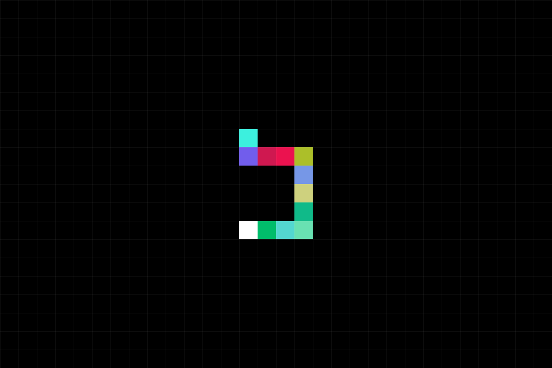
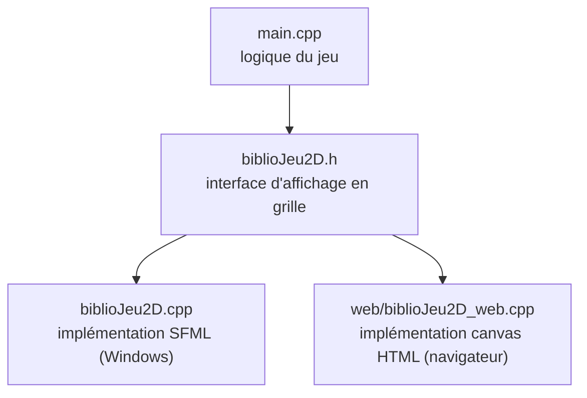

<div align="center">

# Snake

**Jeu Snake en C++ avec SFML, également compilé en WebAssembly pour être joué directement dans le navigateur.**

[](#technologies)
[](https://www.sfml-dev.org/)
[](https://emscripten.org/)
[](#installation)

### [▶ Jouer en ligne](https://nick-suebang.github.io/snake-game/)



</div>

---

## Sommaire

- [Présentation](#présentation)
- [Fonctionnalités](#fonctionnalités)
- [Règles et contrôles](#règles-et-contrôles)
- [Technologies](#technologies)
- [Architecture](#architecture)
- [Structure du dépôt](#structure-du-dépôt)
- [Installation](#installation)
- [Version web](#version-web)
- [Choix techniques](#choix-techniques)
- [Améliorations possibles](#améliorations-possibles)
- [Auteur](#auteur)
- [Licence](#licence)

## Présentation

Ce projet est une version du jeu Snake écrite en C++. Le serpent avance seul sur une grille de 30 × 20 cellules, grandit d'une case chaque seconde et change de couleur à chaque déplacement. Le but est de survivre le plus longtemps possible sans se mordre la queue.

Le même code source tourne de deux façons :

- **sur ordinateur**, comme application Windows compilée avec Visual Studio et SFML ;
- **dans le navigateur**, compilé en WebAssembly avec Emscripten, sans aucune installation pour le joueur.

## Fonctionnalités

- Déplacement automatique du serpent, avec un pas toutes les 250 ms
- Croissance automatique d'une case par seconde
- Passage d'un bord à l'autre de la grille, sans murs
- Demi-tours bloqués, même avec des appuis très rapides ou simultanés
- Couleurs aléatoires renouvelées à chaque déplacement, tête toujours blanche
- Score égal à la longueur finale du serpent
- Version web avec écran d'accueil, écran de fin, bouton Rejouer et commandes tactiles

## Règles et contrôles

| Action | Ordinateur | Navigateur | Mobile |
|---|---|---|---|
| Changer de direction | Flèches ↑ ↓ ← → | Flèches ↑ ↓ ← → | Glisser le doigt sur le jeu |
| Commencer ou recommencer | Lancer le programme | Boutons **Jouer** et **Rejouer** | Boutons **Jouer** et **Rejouer** |
| Quitter | Fermer la fenêtre | Fermer l'onglet | Fermer l'onglet |

La partie se termine quand la tête du serpent touche son propre corps. Le score s'affiche alors dans la console sur ordinateur, et à l'écran dans la version web.

## Technologies

| Domaine | Outil |
|---|---|
| Langage | C++14 (compatible C++17) |
| Affichage et clavier (ordinateur) | [SFML 2.5.1](https://www.sfml-dev.org/), installée par NuGet |
| Environnement de développement | Visual Studio 2022 (outils v143), Windows 10/11 |
| Compilation web | [Emscripten](https://emscripten.org/) 3.1.74, via son image Docker officielle |
| Hébergement | GitHub Pages |

## Architecture

Le jeu ne dépend jamais directement de SFML ni du navigateur. Il passe uniquement par une petite interface, `biblioJeu2D.h`, qui offre une grille de cellules colorées, une horloge et l'état des flèches. Chaque plateforme fournit sa propre implémentation de cette interface :



C'est l'application du **principe d'inversion des dépendances** : la logique dépend d'une abstraction, et non d'une technologie précise. La version web a ainsi été ajoutée sans modifier une seule règle du jeu.

`main.cpp` est lui-même découpé en sections indépendantes :

| Section | Rôle | Fonctions principales |
|---|---|---|
| Logique | Règles du jeu, sans aucun affichage | `InitialiserSerpent`, `DeplacerSerpent`, `AgrandirSerpent`, `CollisionAvecSoi` |
| Entrées | Lecture des flèches, refus des demi-tours | `LireDirection` |
| Affichage | Dessin de la grille et du serpent | `AfficherJeu`, `AfficherFinDePartie` |
| Boucle de jeu | Temps écoulé, enchaînement des étapes | `main` |

## Structure du dépôt

```
snake-game/
├── main.cpp                  # Logique du jeu et boucle principale
├── biblioJeu2D.h             # Interface d'affichage en grille
├── biblioJeu2D.cpp           # Implémentation SFML (version Windows)
├── Snake.sln                 # Solution Visual Studio
├── Snake.vcxproj             # Projet Visual Studio
├── packages.config           # Dépendances NuGet (SFML)
├── web/
│   ├── biblioJeu2D_web.cpp   # Implémentation pour le navigateur
│   └── build.sh              # Script de compilation WebAssembly
└── docs/                     # Site publié sur GitHub Pages
    ├── index.html            # Page du jeu
    ├── snake.js              # Code de chargement généré par Emscripten
    ├── snake.wasm            # Jeu compilé en WebAssembly
    └── images/               # Images du README
```

## Installation

### Prérequis

- Windows 10 ou 11
- [Visual Studio 2022](https://visualstudio.microsoft.com/) avec la charge de travail **Développement Desktop en C++**

SFML n'a pas besoin d'être installée à la main : Visual Studio la télécharge automatiquement par NuGet à la première compilation.

### Compiler et lancer

1. Cloner le dépôt :
   ```bash
   git clone https://github.com/Nick-Suebang/snake-game.git
   ```
2. Ouvrir `Snake.sln` dans Visual Studio 2022.
3. Choisir la configuration **Debug** ou **Release** et la plateforme **x64**.
4. Lancer avec **F5** (avec débogage) ou **Ctrl+F5** (sans débogage).

En cas d'erreur sur SFML, faire un clic droit sur la solution, puis **Restaurer les packages NuGet**.

## Version web

La version web est déjà publiée : **https://nick-suebang.github.io/snake-game/**

### Recompiler

Le seul prérequis est [Docker](https://www.docker.com/). Depuis la racine du dépôt :

```bash
docker run --rm -v "$(pwd):/src" -w /src emscripten/emsdk:3.1.74 sh web/build.sh
```

Le script régénère `docs/snake.js` et `docs/snake.wasm`.

### Tester en local

La page doit être servie par un serveur web, car un navigateur refuse de charger un fichier `.wasm` ouvert directement depuis le disque :

```bash
npx http-server docs
```

Puis ouvrir l'adresse affichée, en général http://localhost:8080.

### Publier

Le site est servi par GitHub Pages depuis le dossier `docs/` de la branche `main` (**Settings → Pages**). Toute modification de ce dossier poussée sur `main` est publiée automatiquement.

### Intégrer le jeu dans un autre site

```html
<iframe src="https://nick-suebang.github.io/snake-game/" width="920" height="720" style="border:0" title="Jeu Snake"></iframe>
```

## Choix techniques

- **Une seule base de code pour deux plateformes.** Seule l'implémentation de `biblioJeu2D.h` change entre Windows et le navigateur. Les règles du jeu ne sont écrites qu'une fois.
- **Une boucle de jeu conservée telle quelle sur le web.** Un navigateur n'accepte pas de boucle `while` infinie. L'option `ASYNCIFY` d'Emscripten permet au programme de rendre la main au navigateur à chaque image, sans réécrire la boucle de `main.cpp`.
- **Un temps mesuré, pas des images comptées.** Le serpent avance selon le temps réellement écoulé, donc à la même vitesse quel que soit l'écran. Après une longue pause, il ne rattrape pas son retard d'un coup.
- **Des demi-tours vérifiés par rapport au dernier déplacement réel.** Deux appuis rapides entre deux déplacements ne peuvent pas faire repartir le serpent sur lui-même.
- **Une mémoire gérée automatiquement.** `std::deque`, `std::vector` et `std::unique_ptr` remplacent les allocations manuelles : aucune fuite, et aucune écriture hors des tableaux.

## Améliorations possibles

- Ajouter de la nourriture à ramasser, pour que la croissance dépende du joueur
- Afficher le score pendant la partie, et pas seulement à la fin
- Conserver le meilleur score
- Augmenter progressivement la vitesse
- Ajouter une pause et un écran de fin dans la version Windows
- Ajouter des tests unitaires de la logique du jeu, exécutés automatiquement par GitHub Actions

## Auteur

**Nick Suebang** · [GitHub](https://github.com/Nick-Suebang)

## Licence

Ce projet est distribué sous licence MIT.
